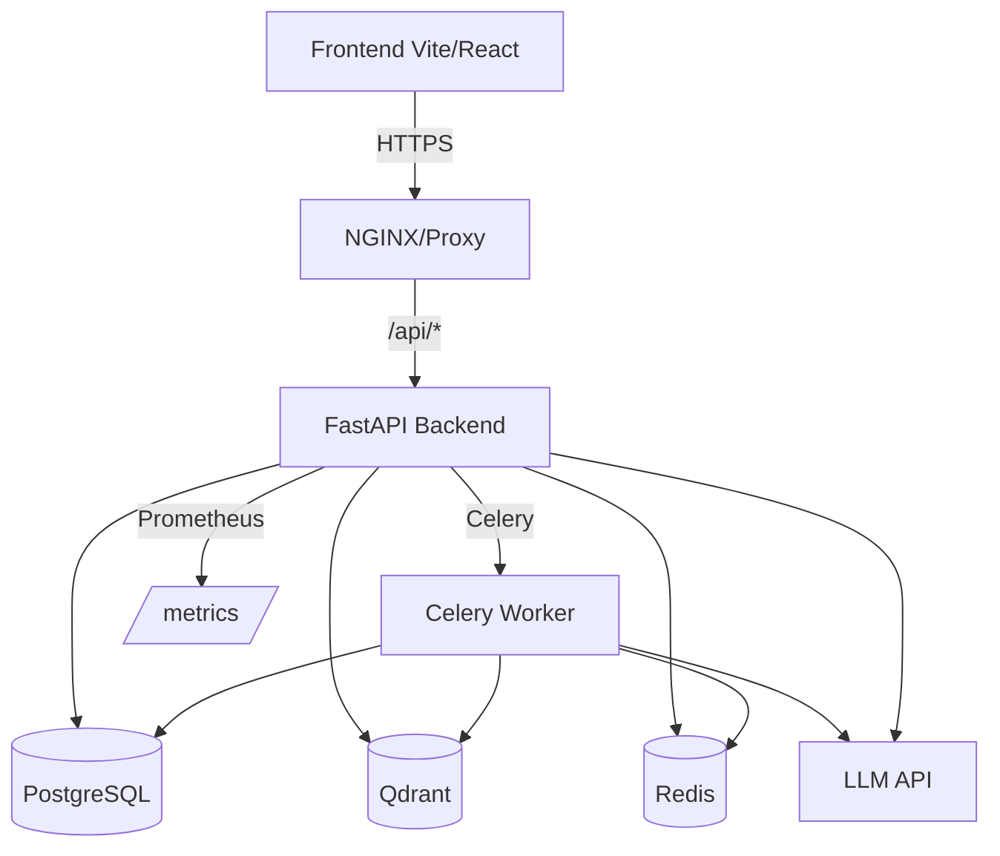

# Enterprise RAG Assistant

An enterprise-ready Retrieval-Augmented Generation (RAG) system with document ingestion, semantic + lexical retrieval, reranking, multi-document grounded Q&A, user authentication with resource ownership, and observability.

## Features
- **Document ingestion**: PDF upload, chunking, deterministic IDs, embedding + Qdrant storage
- **Hybrid retrieval**: Dense + BM25 lexical search with Reciprocal Rank Fusion (RRF)
- **Cross-encoder reranking**: Improves precision of retrieved evidence
- **Grounded Q&A**: Multi-document system prompt with explicit citations
- **Authentication & ownership**: JWT auth, per-user resource isolation
- **Async processing**: Celery worker for ingestion
- **Monitoring**: Prometheus metrics at `/metrics`
- **Production-ready**: Alembic migrations, Docker Compose, health checks

## Architecture



## Quickstart (Local Development)

1. **Clone and setup**
```bash
git clone https://github.com/lYosril/enterprise-rag-qdrant.git
cd enterprise-rag-qdrant
cp .env.example .env  # or configure manually
```

2. **Start services**
```bash
docker compose up -d --build
```

3. **Access**
- Frontend: http://localhost:3000
- API docs: http://localhost:8000/docs
- Health: http://localhost:8000/health
- Metrics: http://localhost:8000/metrics

## Evaluation (Milestone 9)

A retrieval configuration benchmark (A–D) was run on 71 grounded questions from the handbook corpus.

- Dataset: [`backend/evaluation/benchmark_questions.json`](backend/evaluation/benchmark_questions.json) (48 single-passage, 9 multi-passage, 6 confusable_similar, 8 unanswerable)
- Results: [`results/config_benchmark.md`](results/config_benchmark.md) | [`results/config_benchmark.json`](results/config_benchmark.json)
- Configurations: A) Dense top-5, B) Dense top-20 → rerank to top-5, C) Dense+BM25 RRF top-5, D) Hybrid+Rerank top-5

**Metrics (all questions, identical corpus):**
- Retrieval: Recall@5, Hit rate@5, MRR@5 (page-level)
- Generation: Answer correctness, fact coverage, citation validity
- Quality: Abstention quality (unanswerable/answerable)
- Efficiency: Latency (mean/p50/p95), tokens, cost

> Results reflect the actual run (no targets fabricated). Some complex configs show trade-offs (e.g., reranking increases latency; LLM judge behavior depends on evidence quality). See the full Markdown report for per-configuration breakdown.

## Testing

Run the full test suite:
```bash
pytest -v
```

Run specific test modules:
```bash
pytest tests/test_benchmark.py -v  # metric helper unit tests
pytest tests/test_rag.py -v         # RAG + LLM client
pytest tests/test_evaluation.py -v  # legacy evaluation helpers
```

## Demo Video

A short demo video (≤ 2 minutes) showcasing upload, hybrid retrieval, grounded answers with citations, and multi-document Q&A is planned. Add the link here once recorded.

## Deployment

See [`DEPLOYMENT.md`](DEPLOYMENT.md) for production deployment steps (migrations, persistent volumes, HTTPS/CORS, no public DB/Redis/Qdrant ports, Vite build-time API URL).

## License

TBD
